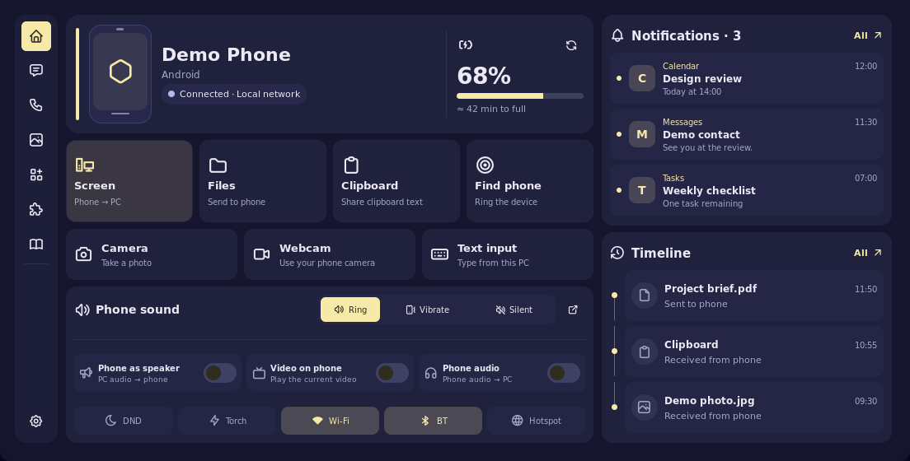

# NectarLink for Noctalia

Phone controls, notifications, messages, calls and photos in a Noctalia panel.
This is an unofficial plugin distributed through a custom Git source.

Requires Noctalia plugin API 32 and the
[NectarLink for Noctalia](https://github.com/vladikchi/nectarlink-noctalia/tree/noctalia)
desktop build. The original NectarLink does not provide the API routes the plugin needs.

See the [plugin guide](nectarlink/README.md#installation) for installation,
features and troubleshooting.
