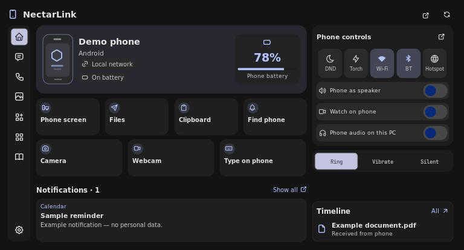

# NectarLink

A compact phone dashboard for Noctalia: notifications, messages, calls, photos,
apps, Deck and session controls in a fixed **860×470** panel. Requires the
**extended-API NectarLink fork** linked below. This is an unofficial integration,
not a release endorsed by the NectarLink or Noctalia teams.



Native Noctalia rendering with synthetic demo data; no personal phone data is
shown. The catalog thumbnail uses the official Noctalia thumbnail generator.

## Plugin

| Field | Value |
| --- | --- |
| ID | `vladikchi/nectarlink` |
| Version | `0.16.0` |
| Entries | Bar widget: `phone`; panel: `controls`; service: `connection` |
| License | GPL-3.0-or-later; see [LICENSE](LICENSE) |

## Requirements

- Linux and Noctalia with **plugin API 52**. Tested with Noctalia **5.5.0**.
- `nectarlink-desktop`: the **extended-API fork**, running as the same user as
  Noctalia, with its local API enabled. An ordinary upstream build is insufficient.
  Put the executable on Noctalia's `PATH`, or set its absolute path in the plugin.
- `xdg-open` (usually provided by `xdg-utils`) for the explicit fork-help button.
  Without it the dashboard still works; the failure notification includes the URL.
- A paired Android phone with permissions for the functions you use. Pairing,
  Android permissions, virtual-camera drivers and app installation are managed
  outside this plugin.

Dependencies are manifest metadata; Noctalia does not install them or verify that
the selected NectarLink binary supports the extended API.

### Obtain the application

Use [vladikchi/nectarlink-noctalia, branch `noctalia`](https://github.com/vladikchi/nectarlink-noctalia/tree/noctalia).
That repository publishes **Linux source code, not a ready integration installer**.
Download or clone that branch, install the build dependencies and build using its
README, launch the resulting binary, pair the phone, and enable the local API.
Then enable this plugin. GitHub's source ZIP is also source code, not an executable.

The upstream Download/Latest release links and `install.sh` are **not substitutes
for building this fork**: they may install a build without the required extensions.
The plugin needs `/v1/page`, `/v1/page-action`, `/v1/sessions`, `/v1/session`,
`/v1/phone-toggle`, `/v1/type`, `/v1/camera` and `/v1/ring`, in addition to device,
notification and timeline reads. An API token alone does not prove compatibility.
Disable the application's upstream auto-updater manually if it would replace the
fork with an incompatible upstream build.

The published branch retains the original application Island. A separate local
Niri variant exists, but is **not distributed by that branch**. Clean-machine
end-to-end installation has not yet been verified.

## Usage

1. Enable `vladikchi/nectarlink` in Noctalia's plugin settings.
2. Add bar widget `phone` (`vladikchi/nectarlink:phone`) to your chosen bar.
   Left or right click opens panel `controls`. The `connection` service starts
   with the plugin; it is an in-process Noctalia service, not a systemd daemon.
3. Use the left navigation for Home, Messages, Calls, Photos, Apps, Deck and Guide.
   The gear opens this plugin's settings, not the application's settings.
4. Select a phone on Home when several devices are paired. File and clipboard
   shortcuts are enabled only for a single online phone; choose the recipient in
   the application when multiple phones exist.

Open or close the panel directly:

```sh
noctalia msg panel-toggle vladikchi/nectarlink:controls
```

SMS/replies, dialing, active-call controls and original-photo downloads require
confirmation. Turning off Wi-Fi also asks for confirmation because it may break
the connection. Apps and configured Deck tiles execute immediately on an explicit
click. Rendering, cache restoration and background polling do not execute actions.
An action with an unknown result is **never automatically retried**; check the
phone/PC before making another attempt. Transport acceptance alone does not clear
a text-input draft.

### Local review installation

Until a community PR is accepted, this plugin is not promised to be available in
the default catalog. For local review, put this directory at
`<review-source>/nectarlink/`, then add the parent as a path source:

```sh
noctalia msg plugins source add nectarlink-review path /absolute/path/to/review-source
noctalia msg plugins enable vladikchi/nectarlink
```

Keep `plugin.toml`, all root `.luau` files, `service/`, `ui/`, `translations/`,
`README.md`, `LICENSE`, `screenshot.webp` and `thumbnail.webp` together. `tests/` is
for development and is not required by the runtime. Do not add an extra nested
directory between `nectarlink/` and `plugin.toml`.

### Moving from `local/nectarlink`

The public ID is a **different Noctalia identity**, not an automatic update of the
old local plugin. Before switching, save pending drafts and back up your Noctalia
configuration. Record the old plugin settings and the named widget's bar position.
Disable `local/nectarlink`, install/enable the public ID, copy those settings to
`vladikchi/nectarlink`, and change the existing named widget's type to
`vladikchi/nectarlink:phone`, keeping its name and bar-order entry. If using the GUI
instead, place the replacement widget at the recorded position. Update custom
panel keybindings to the public command above.

Do not enable both services at once during migration. Keep the old files and
configuration backup until the new identity has been checked. The plugin does
not rewrite Noctalia configuration or migrate it automatically. Pairing, tokens
and application preferences remain in the same application profile; they are not
copied or regenerated. Memory-only drafts and caches do not survive this switch.

## Settings

These are plugin-level settings shared by its entries.

| Setting | Type | Default | Description |
| --- | --- | --- | --- |
| `apps_display` | select | `icons_text` | App grid: `icons` or `icons_text`; also changes the requested page size. |
| `panel_controls` | bool | `true` | Show phone toggles, audio sessions and ringer controls on Home. |
| `show_percentage` | bool | `true` | Show battery percentage in the bar. |
| `show_charging` | bool | `true` | Show the charging glyph in the bar. |
| `show_name` | bool | `false` | Show device name on horizontal bars. |
| `hide_offline` | bool | `false` | Hide the widget when no phone is online. |
| `panel_battery` | bool | `true` | Show battery details in the Home device card. |
| `panel_actions` | bool | `true` | Show Home action cards and the text-entry form. |
| `executable` | file | empty | Absolute NectarLink executable path; empty uses `nectarlink-desktop` on Noctalia's `PATH`. No shell syntax or `~` expansion. |
| `panel_timeline` | bool | `true` | Show and read the recent Home timeline. |
| `panel_notifications` | bool | `true` | Show and read Home notification previews. |
| `panel_navigation` | bool | `true` | Show left navigation. When hidden, use IPC to select sections; the header still offers settings. |

Changing settings may reset in-memory caches. Colors follow Noctalia's theme;
this plugin does not install application palette templates.

## IPC

Select a section in the open panel:

```sh
noctalia msg plugin vladikchi/nectarlink:controls all navigate messages
```

Supported payloads: `home`, `messages`, `calls`, `photos`, `apps`, `deck`, `guide`.
Navigation may read data but never sends an SMS, dials or executes a Deck tile.
The panel also has named UI callbacks for its controls; they are implementation
details, not a public action-automation interface.

Entries communicate through plugin-scoped, memory-only `nl.command` and
`nl.snapshot` state. The token is never included in these snapshots.

## Notes

### Network, files and processes

- **Credentials:** reads `~/.local/share/Nectarlink/api-token.json` before requests,
  validates its token and port, and uses a bearer header. A different application
  data directory is currently not configurable. Tokens are never passed to a
  process, UI state or notification.
- **HTTP:** only `http://127.0.0.1:<validated-port>`. GET reads `/v1/devices`,
  `/v1/timeline?limit=20`, `/v1/notifications`, `/v1/sessions`; read-only POST
  `/v1/page` requests the chosen page/filter. Explicit actions POST to
  `/v1/page-action`, `/v1/session`, `/v1/type`, `/v1/phone-toggle`, `/v1/camera`,
  `/v1/ring`. These may transmit message text, recipients, device/item IDs and
  control choices. The application handles communication with Android.
- **Local images:** checks and renders thumbnail/icon paths returned by the
  authenticated local API. The application creates those previews. The plugin
  does not read the application's database, pairing keys or clipboard history.
- **Writes:** no direct plugin filesystem writes; drafts and caches stay in
  memory. Explicit actions can cause application-side writes, such as downloading
  a photo, transferring files or changing a device feature. No theme, autostart
  or compositor configuration is installed by the plugin.
- **Processes:** on explicit clicks, detached argv launches `nectarlink-desktop`
  (or the configured absolute executable), optionally with `--task open-timeline`,
  `--task send-files` or `--task send-clipboard`. The latter asks the application
  to send clipboard content. Fork help runs `xdg-open` with the fixed URL
  `https://github.com/vladikchi/nectarlink-noctalia`. There is no shell evaluation,
  downloaded executable code or automatic app launch. A successful detached
  launch does not prove the app/browser stayed running or loaded its libraries.

The application is a separate prerequisite with its own UI and side effects;
the plugin's entire interface is rendered using Noctalia's native Luau UI API.
Screenshots and bug reports should exclude credentials, private messages and
pairing data.

### Cache and connection behavior

The service caches successful page responses; the presentation cache restores
content, search, page, conversation and album per phone before the next service
reply. Each cache is bounded to **24 pages / an estimated 4 MiB**, with navigation
limited to **32 entries / 256 KiB**. These are retained-data budgets, not limits
on total Noctalia memory. Oversized successful responses remain displayable but
are not cached. Missing image paths are removed from the display projection.

Fresh service hits need no HTTP. Stale pages refresh in the background, and failed
refreshes keep the last successful result visible. A refresh glyph indicates a
background read; a clock indicates saved data. Reopening a section does not extend
its freshness. Page fields are type-checked before caching. Confirmations and
commands are never restored from a cache.

The service ticks every 2 seconds. Devices normally refresh every 4 seconds while
the panel is open and every 30 seconds while hidden. Home-only reads respect
visibility, with one bounded read-only warmup per connection. No hidden loop
prefetches every section. Request waits expire after 15 ticks; this releases the
UI but does not cancel an action already delivered to the phone.

Observed token/port changes or invalid/missing credentials invalidate all old HTTP
callbacks and cached page data. Detection occurs on credential reads, not through
a file watcher. Busy/pending waits are released; an interrupted action is reported
as having an unknown result. Device/page failures do not generate repeated popup
notifications. An unreadable token file does not prove the application is absent,
and HTTP 403 alone does not identify a specific Android permission.

### Troubleshooting and limitations

| Symptom | Check |
| --- | --- |
| API file unavailable / no connection | Start the fork, enable its API and check that both programs use the same user and standard profile. Preserve the profile. |
| HTTP 404 / unsupported section | Verify the extended-API branch is running, not an upstream release. |
| HTTP 401 | Check user/profile consistency and refresh after restarting the app. Do not bypass authentication. |
| Launch button fails | Set an absolute executable path and check execute permission. Noctalia's PATH can differ from a terminal's. Run the binary in a terminal to diagnose dependencies. |
| Disabled action | Check connectivity, Android permissions, feature switches and current session state. |
| Old data / missing preview | Check the cache indicator, then refresh. Failed refreshes intentionally preserve valid content. |
| Incomplete messenger history | Chats are saved notifications, not full archives; replies require an active notification. SMS needs its own permission. |
| Action timed out | Check the phone/PC before another explicit attempt. Timeout does not undo the command. |
| Reload causes loading | Expected: caches and drafts are memory-only. Auth/config changes and eviction can also require new reads. |
| Clipped UI with large fonts/DPI | The panel is fixed at 860×470. Arbitrary font/DPI combinations have not been fully verified. |
| Plugin fails to load | Check API level, file layout and all relative modules; run `noctalia plugins lint /path/to/nectarlink`. |

The application's HTTP timeout can expire before a slow page operation finishes;
the plugin preserves valid cached content and does not retry consequential actions.
There is no API capability/version handshake. Passing mock tests does not establish
clean-machine installation, every Android permission combination or a full security
audit.

**Niri / Island:** the ordinary public fork preserves the upstream Island behavior.
An invisible idle Island was observed intercepting clicks on Niri 26.04. A separate
local application variant unmaps it, at the cost of losing its manually chosen
position after idle; that variant is not published by the linked branch. A narrow
floating-window rule can help placement but does not fix the invisible surface by
itself. The plugin does not patch or replace Niri. Existing compositor rules and
application palette files are independent of this plugin.

### Localization

UI text and notifications use `noctalia.tr`; English source strings are in
`translations/en.json`. Existing Russian setting translations are retained.
Additional UI translations belong on [Noctalia Translate](https://i18n.noctalia.dev)
under the community workflow; untranslated keys fall back to English. Device names,
messages and notices supplied by the application are displayed as received. One
legacy Russian API notice is matched as protocol data, independent of UI locale.

### Source layout and tests

| Module | Responsibility |
| --- | --- |
| `panel.luau` | Device selection, per-phone drafts/navigation, snapshot acceptance and panel callbacks. |
| `widget.luau` | Compact bar view; suppresses repeated JSON decoding and unchanged renders. |
| `service.luau` | Read scheduling, connection state, timeouts, command routing and explicit app launch. |
| `service/api.luau` | Credentials, auth epoch, HTTP, exactly-once completion and fixed error reasons. |
| `service/pages.luau` | Read-only pages, schema checks, TTL, single-flight, preview checks and cache eviction. |
| `service/actions.luau` | Explicit phone/PC actions, independent generations and no automatic replay. |
| `ui/components.luau` | Shared geometry, text, buttons, cards, pagination and error descriptions. |
| `ui/frame.luau` | Panel frame, header and navigation. |
| `ui/home.luau` | Device card, quick actions, notifications and timeline. |
| `ui/phone_controls.luau` | Device toggles, audio sessions and ringer modes; preserves unknown state. |
| `ui/pages.luau` | Page headings, toolbars, details, confirmations and the five-tab guide. |
| `ui/page_items.luau` | Lists, grids, row selection and offset/cursor pagination. |
| `ui/page_memory.luau` | Per-phone presentation/navigation memory; never owns API freshness or actions. |
| `cache_size.luau` | Bounded-depth estimate of retained data for cache budgets. |

Modules receive dependencies and shared owners explicitly. `pending`/`busy` means
a request is unfinished; `generation` prevents late replies from replacing newer
work, and `epoch` separates authorization/cache lifetimes.

Run tests **from the project root** with system Lua (tested with Lua 5.5.1).
Lua is a development dependency only; Noctalia provides the runtime Luau VM.

```sh
for test in tests/test_*.lua; do
    [ "$test" = tests/test_runtime.lua ] && continue
    lua "$test" || exit 1
done
noctalia plugins lint .
```

| Test | Coverage |
| --- | --- |
| `tests/test_panel.lua` | Geometry, controls, sessions, drafts, settings and UTF-8 rendering. |
| `tests/test_pages.lua` | All pages, confirmations, drafts, call IDs, photos, guide and late replies. |
| `tests/test_service.lua` | API actions, privacy, preferences, request state and no replay. |
| `tests/test_cache.lua` | Warm hits without HTTP, single-flight, stale refresh, auth, previews and eviction. |
| `tests/test_navigation_cache.lua` | Immediate restoration, filters, phone/auth isolation and cache budgets. |
| `tests/test_widget.lua` | Battery, name, orientation, offline visibility and settings. |
| `tests/test_warmup.lua` | Bounded Home warmup without actions or continuous hidden polling. |
| `tests/test_portable.lua` | Detached argv, special characters in paths, relative-path rejection and launch failure. |
| `tests/test_optimizations.lua` | Exactly-once HTTP, token rotation and decode/copy counters. |
| `tests/test_errors.lua` | Credential/HTTP/schema failures, recovery, retained views and explicit help link. |
| `tests/test_auth_schema.lua` | Auth A→B→A, missing credentials, stale callbacks, no replay, schema and renderer fallback. |
| `tests/test_runtime.lua` | Test-only relative-module loader and English translation lookup; not a standalone suite. |

Tests use mock APIs/processes, never the live profile or phone. For a report,
include Noctalia/plugin/fork/compositor versions, section, reproduction steps,
expected/actual behavior and a redacted screenshot or error.
