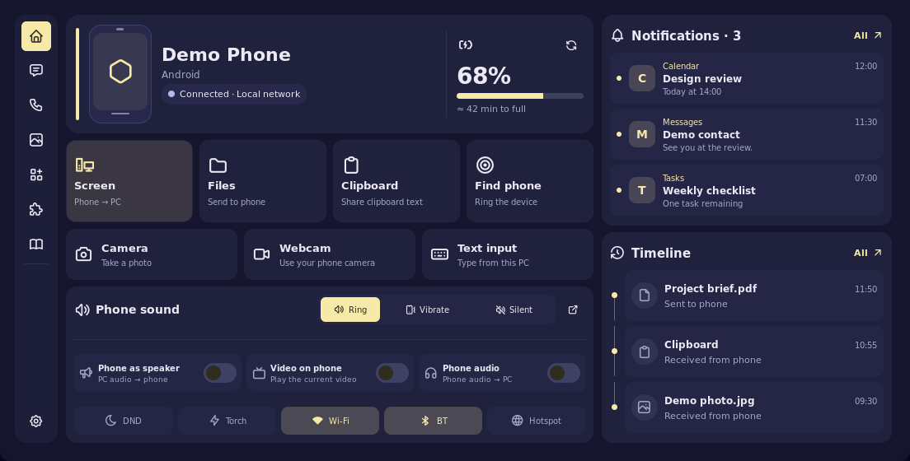

# NectarLink

Control a paired Android phone from Noctalia. Check its battery and notifications, send SMS, manage calls, browse photos, and start screen mirroring, webcam, or audio sessions.



## Plugin

| Field | Value |
| --- | --- |
| ID | `vladikchi/nectarlink` |
| Version | `0.17.2` |
| Panel | 1104 × 560 |
| Entries | Bar widget: `vladikchi/nectarlink:phone`; panel: `vladikchi/nectarlink:controls`; service: `vladikchi/nectarlink:connection` |
| Plugin API | 32 (Noctalia 5.2.0 or later) |
| License | [GPL-3.0-or-later](LICENSE) |

## Requirements

- Install [`nectarlink-desktop`](https://github.com/vladikchi/nectarlink-noctalia/releases/latest) from the **NectarLink for Noctalia** fork. Upstream NectarLink lacks the local API routes this plugin needs. The [desktop source branch](https://github.com/vladikchi/nectarlink-noctalia/tree/noctalia-desktop-only) provides `pageCacheV2`; packaged builds may expose the older API. Run the app as the same user as Noctalia. An AppImage works too: make it executable and set the `executable` option to its absolute path.
- Install `xdg-open` on `PATH` to open the setup guide in your browser.
- Install the [official NectarLink Android app](https://github.com/thtbee/nectarlink/releases/tag/v0.1.5) on your phone and pair it with the desktop app. Available controls depend on Android permissions and device capabilities.

## Usage

1. Start the NectarLink desktop app. Under **Settings → Connection & About**, enable **Local automation API**. If the app exposes the separate **Notifications and messages** toggle, enable it to let the plugin read them.
2. Enable **NectarLink** under **Settings → Plugins**. If installing from the standalone Git source, follow the [source setup guide](https://github.com/vladikchi/nectarlink-plugins#installation) first. The `connection` service starts with the plugin; there is no separate process or systemd unit to start.
3. In **Settings → Panels**, select your bar and open **Widgets**. Add the NectarLink widget (`vladikchi/nectarlink:phone`). It shows the first online phone and its battery state. Left- or right-click the widget to open the controls panel. You can also open it without adding the widget:

   ```sh
   noctalia msg panel-toggle vladikchi/nectarlink:controls
   ```

4. Select a phone in the panel. **Home** shows connectivity, battery, notifications, and recent activity. From there you can ring the phone, use its controls, or start supported screen, webcam, audio, and remote keyboard sessions. The other sections let you browse messages, calls, photos, apps, and Deck tiles configured in NectarLink.

If the panel cannot connect, check that the fork is running and its local API is enabled. If the app connects but the phone is missing, check pairing in NectarLink. The panel's connection check refreshes state without sending commands to the phone.

## Settings

Open the NectarLink settings from Noctalia's plugin list or from the plugin panel.

| Setting | Type | Default | Description |
| --- | --- | --- | --- |
| `apps_display` | `select` | `icons_text` | Shows app icons and labels. Choose `icons` for an icon-only grid. This also changes the number of apps per page. |
| `panel_controls` | `bool` | `true` | Shows phone controls and session cards on Home. |
| `show_percentage` | `bool` | `true` | Shows the battery percentage in the bar widget. |
| `show_charging` | `bool` | `true` | Shows charging status in the bar widget. |
| `show_name` | `bool` | `false` | Shows the phone name on horizontal bars. |
| `hide_offline` | `bool` | `false` | Hides the widget when no phone is online. |
| `panel_battery` | `bool` | `true` | Shows the battery card on Home. |
| `panel_actions` | `bool` | `true` | Shows quick actions and remote typing on Home. |
| `executable` | `file` | Empty | Absolute path to `nectarlink-desktop` or an executable AppImage. If empty, uses `nectarlink-desktop` from Noctalia's `PATH`. `~` and shell syntax are not expanded. |
| `panel_timeline` | `bool` | `true` | Reads and shows recent activity on Home. |
| `panel_notifications` | `bool` | `true` | Reads and shows current notifications on Home. |
| `panel_navigation` | `bool` | `true` | Shows the sidebar. Hiding it does not disable settings or IPC navigation. |

## IPC

With the panel open, navigate directly to a section:

```sh
noctalia msg plugin vladikchi/nectarlink:controls all navigate messages
```

Replace `messages` with `home`, `messages`, `calls`, `photos`, `apps`, `deck`, or `guide`. Navigation may read data but does not execute phone actions. The panel's buttons are not exposed as public IPC commands.

## Notes

- **Network and privacy:** Plugin HTTP requests go only to the desktop app on `127.0.0.1`. If Noctalia inherits an HTTP proxy, add `127.0.0.1` to its `no_proxy` environment variable; the plugin refuses to send credentials without a loopback exception. The plugin reads `~/.local/share/Nectarlink/api-token.json` and checks local preview paths returned by the app. It does not read pairing keys or the NectarLink database. The desktop app handles communication with Android.
- **Files and clipboard:** The plugin does not write files directly. Its caches and drafts live in memory. The setup card copies the installer command to the clipboard only when clicked; it does not download or execute it. Actions requested through the desktop app may write files or change the phone's state.
- **Processes:** On explicit request, the plugin runs `nectarlink-desktop` (or the configured executable) to open the app, timeline, file picker, or clipboard tool. It runs `xdg-open` with the setup guide URL when requested. Both use argument lists without a shell.
- **Phone actions:** The action buttons send requests without a plugin confirmation dialog. Typing, selecting a conversation, and selecting a history row do not send anything. Android may still show its own permission prompts. Turning off Wi-Fi can disconnect the phone. The hotspot menu chooses On or Off explicitly because the phone does not report the hotspot state. Notification-based chats are not full conversation histories. Quick file and clipboard sharing require exactly one online phone. If an action times out, check the phone or PC before trying again: the plugin does not resend it automatically.

## Implementation and tests

<details>
<summary>Architecture, local API, caches, and test coverage</summary>

### Entry points and data flow

| Entry | Source | Role |
| --- | --- | --- |
| `connection` | [`service.luau`](service.luau) | Polls the app, manages connection state, and handles reads and actions. |
| `phone` | [`widget.luau`](widget.luau) | Renders battery and phone status. It does not make HTTP requests. |
| `controls` | [`panel.luau`](panel.luau) | Owns phone selection, pages, drafts, and click guards. It neither reads the token nor makes HTTP requests. |

```text
panel ── nl.command ──► service ── loopback HTTP ──► NectarLink ──► phone
panel and widget ◄──── nl.snapshot ◄──── validated application responses
```

Panel commands carry increasing sequence numbers. The service rejects unknown commands and publishes a new `nl.snapshot` only when its content changes. Snapshots exclude the token. The widget skips duplicate snapshots and only redraws when visible fields change. It checks every 10 seconds for a snapshot it might have missed when it started.

### Service and local API

[`service/api.luau`](service/api.luau) checks that the token is 64 hexadecimal characters and the port is an integer from 1 to 65535. The profile path is fixed. The client sends `Authorization: Bearer …` over loopback HTTP and distinguishes missing credentials, rejected authorization, and unsupported routes. A valid token file does not prove that the running app is compatible.

| Routes | Purpose |
| --- | --- |
| `GET /v1/devices` | Phone list, connection state, battery, and controls. `devicesReady` distinguishes an authoritative empty list from startup. `smsAllowed` and `appWindowsAllowed` are `true`, `false`, or `null` (unknown). `battery.fullInMinutes` is Android's charge estimate in whole minutes, or `null`. Older builds may omit these fields. |
| `GET /v1/timeline?limit=20`, `GET /v1/notifications`, `GET /v1/sessions` | Recent activity, current notifications, and session state. |
| `POST /v1/page` | Reads messages, calls, photos, apps, and Deck. The JSON body carries the phone, section, filters, and pagination parameters. |
| `POST /v1/page-action` | Sends SMS or replies, handles calls, requests originals, opens phone apps, or runs existing Deck tiles. |
| `POST /v1/session`, `POST /v1/type` | Starts or stops a session, or sends text through an active remote keyboard session. |
| `POST /v1/phone-toggle`, `POST /v1/camera`, `POST /v1/ring` | Changes phone controls and ringer mode, opens the camera in `photo` mode, or starts and stops the find-my-phone ring. |

Page errors distinguish the local private-API switch (`not_allowed`), SMS access (`sms_denied`), an unavailable individual chat (`chat_unavailable`), and a device feature (`feature_denied`). When the feature matrix provides a reason, `feature_denied` includes a stable upgrade action (such as `raisePower` / `elevated` for Apps) or `unsupported: true`. Older builds may omit the reason.

The service ticks every two seconds. It normally refreshes devices every four seconds with the panel open and every 30 seconds with it closed. Home reads respect notification and timeline settings and are warmed once per API binding. Closing the panel stops refreshes of the visible page. With `pageCacheV2`, [`service/warmup.luau`](service/warmup.luau) waits ten seconds after observing a stable connection and then warms the first screen of Messages, Photos, and Apps for the selected phone, one read at a time. An open panel pauses the queue and can join a read already in progress. Each section gets one attempt, and a section already filled by a visit is skipped. A timeout, expired cache, or short reconnect does not start another queue. A confirmed grant can rearm the affected section. Warmup never dispatches actions.

The service rereads the token file to detect changes to the token or port. Credential changes discard stale responses and prepared requests, even if the previous credentials reappear. The client does not follow redirects. An action started under old credentials is not sent again under new ones.

Desktop builds that report private-access and notification-rule generations use opaque app tags. Hiding an app removes its cached notification rows and conversations, including any open text, without clearing SMS, other chats or other sections. Pending reads from before the rule changed cannot restore those rows. The plugin learns changes from its existing device read; it does not add a poll.

[`service/actions.luau`](service/actions.luau) handles page actions, sessions, text input, phone toggles, camera, and the find-my-phone ring. For page actions and phone toggles, the panel binds the target, creates a request ID, and locks the controls immediately. The service echoes only the opaque ID to acknowledge receipt, not success. Switches reflect the next device read rather than changing optimistically. The existing API flags `confirm` and `confirm_disconnect` still carry explicit intent from the click; the API is unchanged. Rendering, polling, and restoring pages never run actions. The service reports rejection or timeouts without automatically retrying.

Remote typing accepts nonempty text up to 16 KiB and requires an online phone with the remote keyboard enabled. A transport result (`sent`) is not proof the text appeared on Android. The draft remains unless the result explicitly reports `acknowledged`.

The launch helper passes `--task send-files`, `--task send-clipboard`, or `--task open-timeline` for the corresponding shortcuts. The file picker launches only after the plugin panel closes, so it can take keyboard focus on Niri. Before exposing app icons or photo thumbnails, the service checks the paths returned by the app. The app, not the plugin, creates those previews.

### Response and view caches

[`service/pages.luau`](service/pages.luau) owns the response cache, in-flight reads, and cooldowns. [`service/page_data.luau`](service/page_data.luau) validates replies and projects previews without changing cached rows. Invalid responses do not replace the last valid data. The cache key includes the phone, section, conversation, album, pagination timestamp and ID, offset, search, and page size. A cooldown retains its phone, section, and failure reason independently of this key.

| Section | Freshness |
| --- | ---: |
| Messages | 20 s |
| Calls | 4 s |
| Photos | 120 s |
| Apps | 300 s |
| Deck | 30 s |

A fresh response avoids HTTP. Age uses `nowMs()` when available and service ticks otherwise. Identical in-flight reads are coalesced. Forced reads bypass freshness and the roughly 30-second cooldown after an error, but do not duplicate an in-flight request. Old data stays visible during refresh and is retained with an error if refresh fails.

On a cold first page of Messages, a desktop build advertising `localMessageThreads` can return saved notification conversations while the normal request is still fetching SMS. These chats can be opened before SMS arrives. With `pageCacheV2`, all conversation-list offsets share one bounded index per phone. The plugin slices it locally without a phone request; neither an incomplete SMS result nor a local chat database error can replace a complete index. The refresh button updates both the list and the open conversation without resetting either cursor. SMS history within an individual thread is still read separately.

With `pageCacheV2`, Photos first returns rows and cached thumbnails. The plugin shows those immediately, then asks for missing thumbnails and albums. NectarLink uses its disk thumbnail cache; the plugin does not store photos or messages on disk. The Apps list and click-to-launch path share the desktop app catalogue when it contains a recent match. A confirmed Apps permission grant rearms one background read. Builds that do not advertise `pageCacheV2` use standard page queries.

The response cache keeps at most 24 entries with an estimated combined budget of 4 MiB. It evicts least recently used entries, preferring to keep the conversation index, the first photo and app pages, and the last viewed photo page within the same limits. [`cache_size.luau`](cache_size.luau) estimates strings and tables, avoids revisiting cycles, and caps traversal depth at 64. This is not a measurement of Noctalia's memory use. A valid response that is too large may be displayed without being cached. When a preview is missing, only the affected rows and their containing tables are copied. A timeout or temporary disconnect retains previous successful reads. Authorization loss clears the cache; confirmed phone removal or revoked page access clears only the affected data. Unrelated UI settings do not reset it. After an action, `invalidateKind()` targets the affected section and phone.

[`ui/page_memory.luau`](ui/page_memory.luau) keeps up to 24 rendered views within 4 MiB. Separate navigation memory keeps up to 32 phone/section entries within 256 KiB, including search, pagination, conversation, album, and recipient selection. It does not save failed or incomplete loads as finished views, nor does it keep pending actions. Back navigation can show a saved view while a fresh read runs. A grid resize changes the page size and therefore the cache key. Both caches are lost when Noctalia restarts.

### UI modules

`panel.luau` keeps the selected device, drafts, cursors, and click guards. `navigate()` saves a valid outgoing view. `onOpen()` takes the latest snapshot. While closed, the panel can retain the raw snapshot without parsing JSON on every background poll. Closing it invalidates previously rendered action callbacks. First-time setup, a known offline device, and a transient connection failure are shown as distinct states.

| Module | Responsibility |
| --- | --- |
| [`ui/components.luau`](ui/components.luau) | Shared sizing, buttons, cards, pagination, errors, and app grid sizing. |
| [`ui/frame.luau`](ui/frame.luau) | Fixed panel frame, navigation rail, and settings access. |
| [`ui/home.luau`](ui/home.luau) | Setup, quick actions, notifications, timeline, remote typing, and controls. |
| [`ui/pages.luau`](ui/pages.luau) | Shared section frame, loading and error states, and photo preview with a direct download button. |
| [`ui/page_calls.luau`](ui/page_calls.luau) | History alongside a dialer. The number field, on-screen keys and history entries edit the same draft. |
| [`ui/page_messages.luau`](ui/page_messages.luau) | Conversation list and selected SMS or notification records. Long messages paginate at UTF-8 character and line boundaries. |
| [`ui/page_forms.luau`](ui/page_forms.luau), [`ui/page_guide.luau`](ui/page_guide.luau) | SMS composer, app search and album toolbars; local guide topics and setup instructions. |
| [`ui/page_items.luau`](ui/page_items.luau) | Call history cards, photo, app and Deck grids, and shared cursor or offset pagination. |
| [`ui/phone_controls.luau`](ui/phone_controls.luau) | Phone toggles, ringer modes, and sessions. Unknown state is not treated as off; unavailable features are not offered as ready. |
| [`ui/page_memory.luau`](ui/page_memory.luau) | Saved views and navigation, separate from the network cache. |
| [`ui/palette.luau`](ui/palette.luau) | Noctalia color roles and fallback names. It does not read the desktop app's palette file. |

The UI uses native Noctalia elements, theme colors, and [translation keys](translations/en.json). Phone and app content is not translated. The panel stays 1104×560 across sections. In Messages, the conversation list uses the current phone's cached view while the selected thread is read, with separate pagination for the two panes. Following another thread or moving the list does not send messages. The Apps search and pager share one toolbar, and grid capacity depends on the display mode and available width. Photos keep their album and cursor behind the preview. The guide has four cards per topic and works without a phone.

### Test coverage

The runtime needs the manifest, root Luau modules, `service/`, `ui/`, and `translations/`. The screenshot, store thumbnail, and `tests/` are not needed at runtime. The standalone source's root `catalog.toml` belongs to the Git source, not to this plugin directory.

| Tests | Coverage |
| --- | --- |
| `test_runtime.lua` | Shared test harness for Noctalia, HTTP, translations, and processes; not a standalone suite. |
| `test_auth_schema.lua` | Credential changes, stale responses, and data validation. |
| `test_cache.lua`, `test_navigation_cache.lua` | Freshness, refresh failures, restoration, phone isolation, memory limits, and missing previews. |
| `test_errors.lua`, `test_service.lua` | API states, polling, snapshots, commands, timeouts, and no automatic resend. |
| `test_optimizations.lua`, `test_warmup.lua` | Coalesced reads, duplicate snapshots, and limited warmup without polling hidden sections. |
| `test_pages.lua`, `test_panel.lua`, `test_setup.lua` | Pagination, one-click actions, duplicate guards, phone selection, and setup. |
| `test_compat.lua`, `test_widget.lua` | UI structure, theme roles, orientation, battery, and display settings. |
| `test_portable.lua` | Argument-list process launches and executable path handling. |

Run from the plugin directory in the standalone repository:

```sh
for test in tests/test_*.lua; do
    [ "$test" = tests/test_runtime.lua ] && continue
    lua "$test" || exit 1
done
noctalia plugins lint .
```

Tests use stubs instead of a real profile, phone, or HTTP connection. They do not replace testing with Android in a live Noctalia session.

</details>
